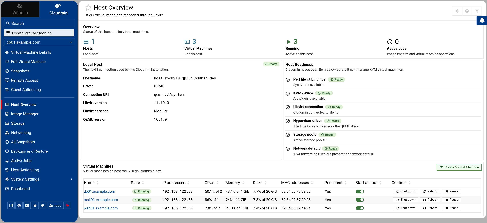

# Cloudmin 10

Cloudmin 10 manages QEMU/KVM virtual machines on one host through libvirt, from Webmin. GPL supports unlimited virtual machines.

<p align="center">
  <picture>
    <source media="(prefers-color-scheme: dark)" srcset="docs/images/host-overview-dark.png">
    
  </picture>
</p>

## Supported hosts and installation

Start with a fresh **Rocky Linux 10**, **AlmaLinux 10**, **Debian 13** or **Ubuntu 26.04** host, on x86-64 or ARM64 with KVM available. The host matrix does not limit guest OS choices.

`cloudmin-install.sh` is the only supported installation method. Run this on the host:

```sh
sudo sh -c "$(curl -fsSL https://download.cloudmin.dev/cloudmin-install.sh)"
```

Cloudmin 10 is in development; the installer currently uses the unstable channel. Cloudmin ships with a matching Webmin release and uses the distribution's hypervisor packages.

See [Installation](https://www.cloudmin.com/docs/installation/automated/) and [Host requirements](https://www.cloudmin.com/docs/installation/host-requirements/).

## First virtual machine

On Pro hosts, open [**System → Settings → License Manager**](docs/licensing.md) to add or recheck the host license. GPL does not require a license.

1. Log in to Webmin at `https://your-hostname:10000`, open **Cloudmin**, and choose **Create Virtual Machine**.
2. Name the virtual machine and choose a catalogue image. **Default Template** selects Rocky Linux 10 for the host architecture.
3. Choose a resource plan for CPU, memory and disk size.
4. Set the guest account, password or SSH keys, and network settings.
5. Click **Create Virtual Machine**. When setup finishes, open **Remote Access** for a console or SSH terminal.

See [How to create a virtual machine](https://www.cloudmin.com/docs/getting-started/how-to-create-a-virtual-machine/).

## What you get

- [Image imports and a maintained catalogue](https://www.cloudmin.com/docs/images/image-manager/).
- Creation from [cloud images](https://www.cloudmin.com/docs/getting-started/how-to-create-a-virtual-machine/) and [installer ISOs](https://www.cloudmin.com/docs/virtual-machines/installer-iso/) (experimental).
- [Machine templates and resource plans](https://www.cloudmin.com/docs/virtual-machines/templates-and-plans/).
- [Live hardware changes and virtual machine management](https://www.cloudmin.com/docs/virtual-machines/managing-virtual-machines/).
- [Host and virtual machine statistics with local history](docs/statistics.md).
- [Disk snapshots with restore and history](https://www.cloudmin.com/docs/virtual-machines/snapshots/).
- [Full virtual machine clones](https://www.cloudmin.com/docs/virtual-machines/cloning/).
- [Full backups, restore, schedules and retention](https://www.cloudmin.com/docs/backup-and-migration/backups-and-restore/).
- [Graphical and serial consoles](https://www.cloudmin.com/docs/remote-access/consoles/) and a [browser SSH terminal](https://www.cloudmin.com/docs/remote-access/ssh-terminal/).
- [Virtual networks and host bridges with automatic recovery](https://www.cloudmin.com/docs/networking/virtual-networks-and-bridges/).
- File storage, LVM and LVM-thin guest disks. Register existing volume groups in Storage; use Webmin's Logical Volume Management module to create and extend volume groups and thin pools.
- [Delegated access through Webmin permissions](https://www.cloudmin.com/docs/getting-started/how-to-delegate-access/).
- [One API for the UI, command line, `api.pl` and remote clients](https://www.cloudmin.com/docs/development/virtual-machine-api/).
- [Isolated workers running without root](https://www.cloudmin.com/docs/development/privilege-separation/).

## Editions and fleet management

Cloudmin GPL manages one host with unlimited virtual machines. It includes access controls, the CLI and API, guest packages, Virtualmin installation templates, consoles, networks, bridges, storage, clones, snapshots, backups, schedules, retention and restore.

Cloudmin Pro adds custom setup scripts, image capture and additional cloud backup destinations. GPL shows disabled previews of these features by default. To hide them, set **Show Pro features overview?** to **No** in Module Configuration.

Cloudmin Connect is planned as a separate product for managing multiple Cloudmin hosts, with GPL and Pro editions. It will neither unlock host Pro features nor restrict operations performed directly on a GPL host. Virtualmin Connect is planned for managing multiple Virtualmin servers. See [Professional features](https://www.cloudmin.com/docs/professional-features/) and the [roadmap](https://www.cloudmin.com/docs/roadmap/).

## Documentation

- [User documentation](https://www.cloudmin.com/docs/) and [command-line reference](https://www.cloudmin.com/docs/development/command-line/).
- [Virtual machine API](docs/machine_creation_api.md).
- [Worker isolation](docs/workers.md).
- [Backups and restore](docs/backups.md).
- [Image capture](docs/machine_images.md).
- [Architecture and release design](docs/cloudmin-10-design.md), and [function names and theme integration](docs/function-names.md).
- [In-module help](help/), also available from the help icons in Cloudmin.
- [Changelog](https://www.cloudmin.com/changelog/cloudmin-10.0-released/).

## Development

Run the unit tests from the module directory with a Webmin source checkout beside it, or from an installed module:

```sh
prove t/
for test in t/*.js; do node "$test" || exit; done
python3 t/software-guest.py
```

See [test setup](docs/workers.md#tests) for Webmin path overrides and running as an unprivileged user.

Tests under `t/live/` require a disposable Linux test host and root. Pro tests live in the separate `cloudmin-pro` repository.

License: GNU General Public License, as marked by `gpl=1` in [module.info](module.info).
